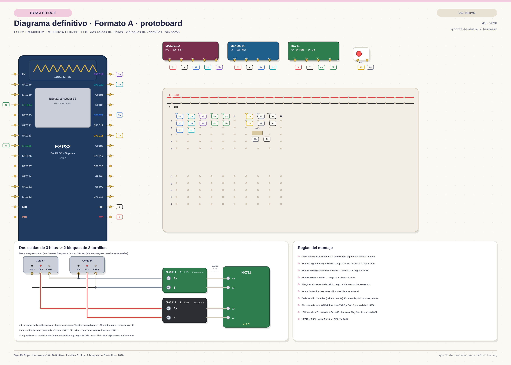

# Hardware design

Physical design artifacts for the two form factors.

## Format A — fixed check-in station (totem / grip station)

- Mains/USB powered, on a warm-up desk.
- MAX30102 (finger PPG) and MLX90614 (thermal) plus a grip handle on the HX711
  load cell.
- Maximum optical stability; easiest to demonstrate to an evaluation panel.

## Format B — wearable wrist band

- Elastic ergonomic band keeping the optical and thermal sensors on the wrist
  during dynamic warm-up, with a coupling for the grip dynamometer.
- LiPo battery; continuous monitoring.

## Definitive Format A diagram

- [`definitive.svg`](definitive.svg) — editable A3 vector diagram.
- [`definitive.png`](definitive.png) — high-resolution export.
- [`connection-map.md`](connection-map.md) — exact pin-to-hole map, two 3-wire
  cells with their two 2-position blocks, LED, no tare button and serial
  calibration.
- [`pinout.md`](pinout.md) — full ESP32 pinout and bring-up checks.
- [`bom.csv`](bom.csv) — bill of materials.

The definitive build uses:

- **400-point breadboard** as a bus; the ESP32 and modules stay **free**.
- **X = +3V3**, **Y = GND** (the board has only one pair of rails).
- **Two identical 3-wire half-bridge load cells** in a full bridge: the **red**
  centre wire of each cell goes to `A+` / `A−`, and the ends are crossed —
  white A + black B → `E+`, black A + white B → `E−`.
- **Two 2-position screw blocks** (one green, one black) as the cell junction:
  green = `E+`/`E−`, black = `A+`/`A−`; one net per screw.
- **No tare button**: GPIO4 is left free; use the serial command `TARE`.
- **LED** on GPIO18 through a **330 Ω** resistor (220 Ω–1 kΩ acceptable).
- **M-F** jumpers from components to the breadboard; **M-M** only inside the
  board. **F-F** is not needed.

## Final pinout (ESP32 DevKit V1, 30-pin)

| Sensor / function | Signal | ESP32 pin |
|-------------------|--------|-----------|
| MAX30102 | SDA / SCL | 21 / 22 |
| MAX30102 | INT | 23 |
| MLX90614 | SDA / SCL | 21 / 22 (shared I2C) |
| HX711 | DT / SCK | 34 / 25 |
| Two 3-wire cells | reds → `A+`/`A−`; ends crossed → `E+`/`E−` | 2-position blocks → HX711 |
| Status LED | GPIO → 330 Ω → LED → Y | 18 |
| Buzzer (optional) | GPIO → NPN | 17 |
| Battery ADC (Format B) | divider 100k/100k | 35 |
| USB-C | 5 V / programming | integrated |

**Notes.** HX711 runs at 3.3 V. Mount the two cells the same way, both compressed
by the load: with the crossed ends their signals add. The final capacity
depends on the mount (shared load can approach 2× the single-cell rating). Use a
mechanical stop. I2C pull-ups are 4.7 kΩ to X only when the modules do not
already include them.

## Still to add

- [ ] Electrical schematic (not only the wiring/assembly diagram)
- [ ] Enclosure drawings for Formats A and B
