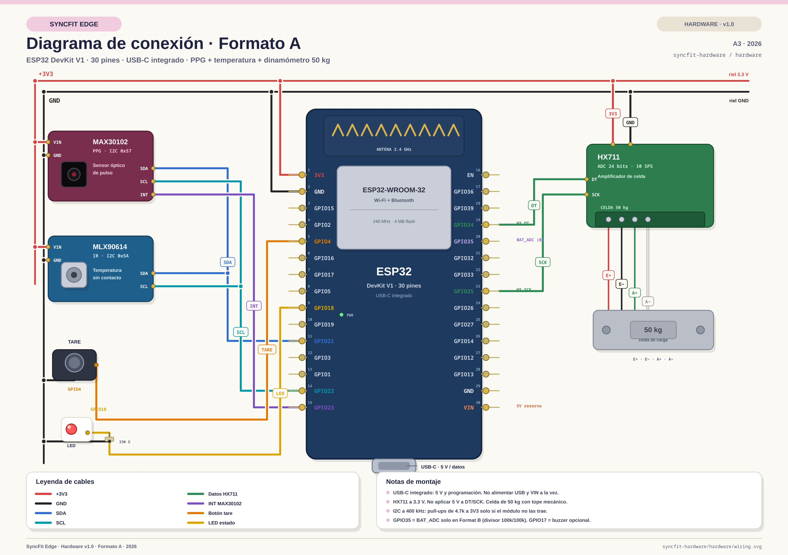
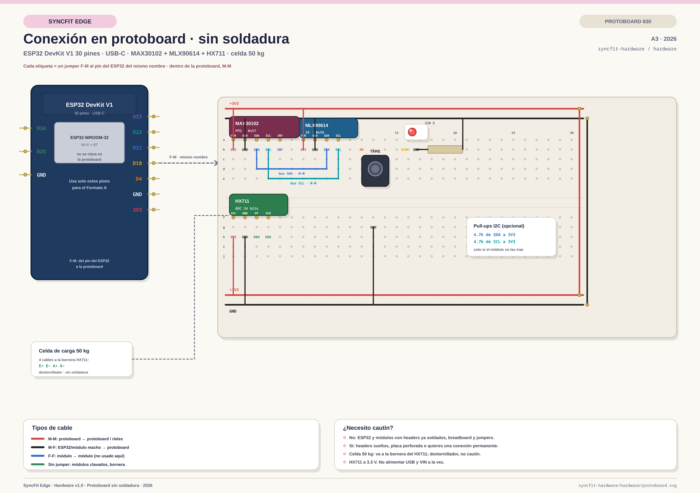

# Hardware design

Physical design artifacts for the two form factors.

## Format A — fixed check-in station (totem / grip station)

- Mains/USB powered, on a warm-up desk.
- MAX30102 (finger PPG) and MLX90614 (thermal) plus a grip handle on the HX711
  load cell.
- Maximum optical stability; easiest to demonstrate to an evaluation panel.

## Format B — wearable wrist band

- Elastic ergonomic band keeping the optical and thermal sensors on the wrist
  during dynamic warm-up, with a coupling for the grip dynamometer.
- LiPo battery; continuous monitoring.

## Format A wiring (ESP32 DevKit V1, 30-pin, USB-C)

- [`wiring.svg`](wiring.svg) — editable vector diagram (A3).
- [`wiring.png`](wiring.png) — high-resolution export for reports.
- [`pinout.md`](pinout.md) — full pinout, connectors and bring-up checks.
- [`bom.csv`](bom.csv) — bill of materials, including the 50 kg load cell.

## Protoboard build (solderless)

- [`protoboard.svg`](protoboard.svg) — editable breadboard layout.
- [`protoboard.png`](protoboard.png) — high-resolution export.
- [`protoboard.md`](protoboard.md) — net-by-net wiring list, jumper types
  (M-M / M-F / F-F) and soldering-iron checklist.

The ESP32 stays beside the breadboard; use **M-F** jumpers from its male pins to
the breadboard. Modules with male headers plug directly into the breadboard.
The 50 kg load cell goes to the HX711 screw terminal (screwdriver, no solder).

## Final pinout (ESP32 DevKit V1, 30-pin)

| Sensor / function | Signal | ESP32 pin |
|-------------------|--------|-----------|
| MAX30102 | SDA / SCL | 21 / 22 |
| MAX30102 | INT | 23 |
| MLX90614 | SDA / SCL | 21 / 22 (shared I2C) |
| HX711 | DT / SCK | 34 / 25 |
| Load cell | E+ / E- / A+ / A- | HX711 terminal |
| Tare button | GPIO to GND | 4 |
| Status LED | GPIO → 330 Ω → LED | 18 |
| Buzzer (optional) | GPIO → NPN | 17 |
| Battery ADC (Format B) | divider 100k/100k | 35 |
| USB-C | 5 V / programming | integrated |

**Notes.** HX711 runs at 3.3 V. The 50 kg load cell is the rated limit: use a
mechanical stop and avoid maximum grip tests without it. I2C pull-ups are
4.7 kΩ to 3V3 only when the modules do not already include them.

## Still to add

- [ ] Schematic (electrical, not only wiring)
- [ ] Enclosure drawings for Formats A and B
