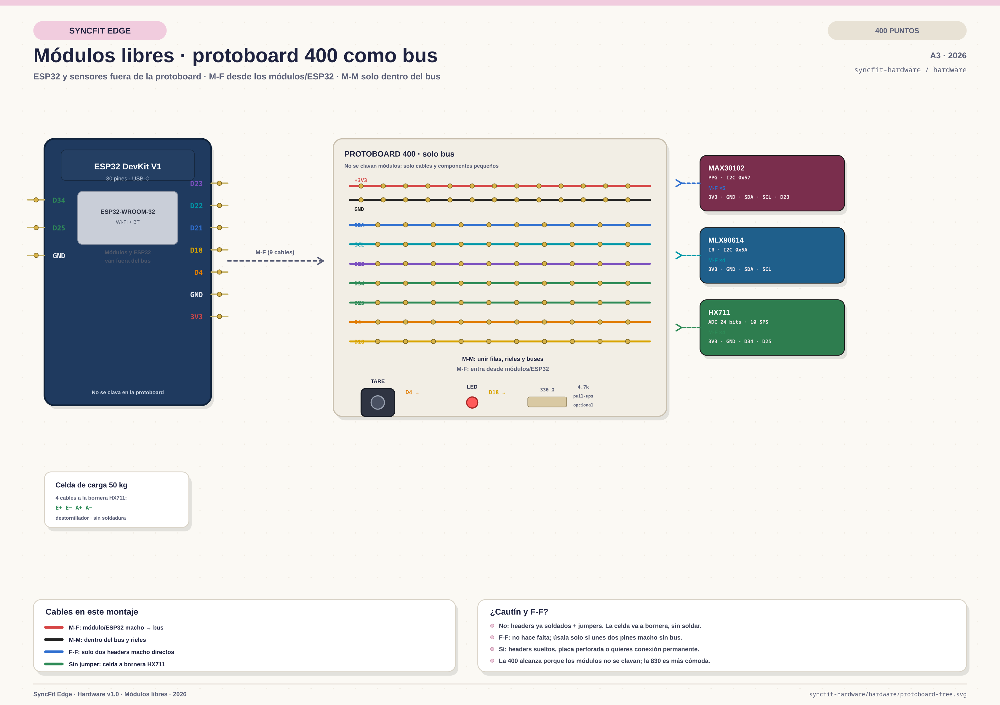

# SyncFit Edge — protoboard assembly (Format A)

**Board:** ESP32 DevKit V1, generic 30-pin, USB-C.  
**Assumption:** solderless breadboard and modules with **pre-soldered male headers**.  
**Recommended breadboard:** **830 points**. A 400-point board only works if the
sensor modules are left **free** beside it.  
**Your 400-point board:** one pair of rails, **X = +3V3** and **Y = GND**. The
red/black rails in the drawings mean X/Y.  
**Diagram (modules on board, if they fit):** [`protoboard.svg`](protoboard.svg) · [`protoboard.png`](protoboard.png)  
**Diagram (400-point board as a bus, modules free — recommended):**
[`protoboard-free.svg`](protoboard-free.svg) · [`protoboard-free.png`](protoboard-free.png)

> If your modules have loose headers or you use a perfboard instead of a
> solderless breadboard, you need a soldering iron. See "Do I need a soldering
> iron?" below.

## 1. Jumper types

| Type | What it is | Where to use it |
|---|---|---|
| **M-M** | Male–male | Breadboard row to breadboard row, power rails, short bus links |
| **M-F** | Male–female | ESP32 male pin → breadboard hole; **free module** male pin → breadboard hole |
| **F-F** | Female–female | Only module-to-module when both sides have male pins; not needed in this breadboard layout |

In this build:

- The **ESP32 stays beside the breadboard**. Use **M-F** jumpers: female end on
  the ESP32 male pin, male end into the breadboard.
- The **MAX30102, MLX90614 and HX711 can plug directly into the breadboard** if
  they fit. For a 400-point board, or if the modules are physically large,
  leave them **free** beside the board and connect each pin with an **M-F**
  jumper. This is the recommended option for this build.
- Use **M-M** jumpers to link breadboard rows, the I2C bus and the power rails.
- The **50 kg load cell** goes to the HX711 screw terminal. No jumper and no
  soldering iron are required; use a small screwdriver.

## 2. 400 or 830 points?

| Board | Verdict |
|---|---|
| **400 points** | Very tight. Only if the ESP32 and all sensor modules stay **free** and the breadboard is used just for power, I2C, button, LED and resistors. It may lack long power rails. |
| **830 points** | Recommended. Enough rows for the power rails, I2C bus, button, LED, pull-ups and spare space. |

The layout in the diagram uses 30 columns. It is designed for an **830-point**
board; a 400-point board will require shortening the bus and moving the modules
further away.

## 3. Free modules (recommended if they do not fit)



1. Do **not** force the sensor PCBs into the breadboard.
2. Place the ESP32 and the three modules on the table, around the breadboard.
3. Connect each module pin to the breadboard with an **M-F** jumper: female end
   on the module's male header, male end into the breadboard row.
4. Connect the ESP32 pins to the same net rows with **M-F** jumpers.
5. Use **M-M** jumpers only inside the breadboard (power rails, SDA/SCL bus,
   button to GND, LED resistor to GND, pull-ups).

This avoids mechanical stress on the module headers and is the practical option
for the 400-point board. The 830-point board is still recommended because it
gives you room for the bus and the power rails.

## 4. Breadboard layout

```
Top power rail:  +3V3 (red)  ·  GND (black)
Top block:       MAX30102 (cols 1-5)   MLX90614 (cols 7-10)
                 button (cols 12-13)   LED + 330Ω (cols 15-19)
Center channel
Bottom block:    HX711 (cols 1-4)
Bottom power:    +3V3 / GND, linked to the top rails with M-M
```

If the modules fit, place them so their pins sit in different columns. Each
column's five holes (a–e above, f–j below) are internally connected. If they do
not fit, leave them free and land their nets on the breadboard with M-F jumpers
as described in section 3.

## 5. Connection list

### ESP32 → breadboard (all M-F)

| Net | ESP32 pin | Breadboard destination | Jumper |
|---|---|---|---|
| `3V3` | `3V3` (right, pin 30) | top `+3V3` rail | M-F |
| `GND` | `GND` (right, pin 29) | top `GND` rail | M-F |
| `SDA` | `GPIO21` (right, pin 20) | SDA bus column (MAX/MLX SDA) | M-F |
| `SCL` | `GPIO22` (right, pin 17) | SCL bus column (MAX/MLX SCL) | M-F |
| `MAX_INT` | `GPIO23` (right, pin 16) | MAX30102 `INT` column | M-F |
| `HX_DT` | `GPIO34` (left, pin 4) | HX711 `DT` column (bottom block) | M-F |
| `HX_SCK` | `GPIO25` (left, pin 8) | HX711 `SCK` column (bottom block) | M-F |
| `TARE` | `GPIO4` (right, pin 26) | button column | M-F |
| `LED` | `GPIO18` (right, pin 22) | LED anode column | M-F |
| `BAT_ADC` | `GPIO35` (left, pin 5) | not connected in Format A | — |

### On the breadboard (all M-M)

| Connection | From | To | Jumper |
|---|---|---|---|
| MAX30102 power | MAX `VIN` | top `+3V3` rail | M-M |
| MAX30102 ground | MAX `GND` | top `GND` rail | M-M |
| MLX90614 power | MLX `VIN` | top `+3V3` rail | M-M |
| MLX90614 ground | MLX `GND` | top `GND` rail | M-M |
| I2C SDA bus | MAX `SDA` | MLX `SDA` + ESP32 `SDA` | M-M + M-F |
| I2C SCL bus | MAX `SCL` | MLX `SCL` + ESP32 `SCL` | M-M + M-F |
| HX711 power | HX711 `VCC` | bottom `+3V3` rail | M-M |
| HX711 ground | HX711 `GND` | bottom `GND` rail | M-M |
| Button ground | button leg 2 | bottom `GND` rail | M-M |
| LED cathode | LED cathode | 330 Ω → bottom `GND` rail | M-M |
| Pull-up SDA | 4.7 kΩ | `SDA` bus ↔ `+3V3` | M-M |
| Pull-up SCL | 4.7 kΩ | `SCL` bus ↔ `+3V3` | M-M |

**I2C pull-ups:** add the two 4.7 kΩ resistors only if the MAX30102/MLX90614
modules do not already include them. Do not duplicate pull-ups.

**Load cell:** HX711 screw terminal `E+ / E- / A+ / A-` to the load-cell wires
`red / black / green / white`. Use a screwdriver, not a soldering iron.

## 6. Do I need a soldering iron?

### No, for a pure breadboard build if:

- The ESP32 already has its male headers soldered (your photo shows the headers
  in place).
- The MAX30102, MLX90614 and HX711 modules already have their male headers
  soldered.
- You use a breadboard and M-M/M-F jumpers.
- The load cell goes to the HX711 screw terminal.

### Yes, if:

- The modules came with **loose headers** that must be soldered before use.
- You use a **perfboard / protoboard with soldered connections** instead of a
  solderless breadboard.
- You want a permanent build, a PCB, or want to shorten/tin the load-cell wires.
- You need to solder a connector to the load cell because your HX711 has a
  4-pin header instead of a screw terminal.

**Tools for the no-solder build:** breadboard, M-M and M-F jumpers, small
screwdriver for the HX711 terminal, USB-C cable, multimeter (recommended).
**Optional:** 4.7 kΩ and 330 Ω resistors, button, LED.

## 7. Bring-up order

1. With USB-C disconnected, check for shorts between `3V3` and `GND`.
2. Connect USB-C and measure ~3.3 V between the `3V3` and `GND` rails.
3. Run an I2C scan: expect `0x57` (MAX30102) and `0x5A` (MLX90614).
4. Connect the HX711 and load cell; run `TARE`.
5. Put a known weight on the load cell and run `CAL <kg>`.
6. Test the button and LED.
7. Send telemetry to the local WebSocket, not production, until the hardware
   is validated.

**Safety:** HX711 at 3.3 V only. Do not feed `VIN` and USB-C at the same time.
The 50 kg load cell is the rated limit; use a mechanical stop and avoid maximum
grip tests without it.
